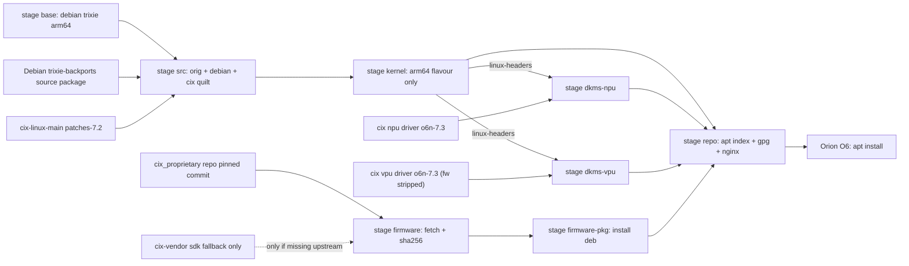
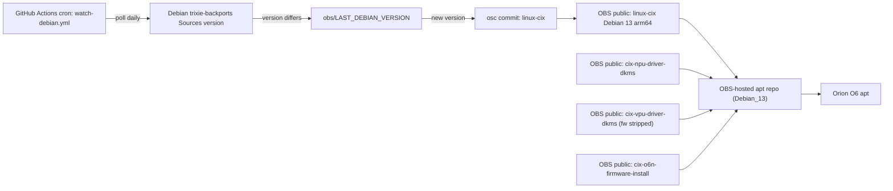

# O6N Debian 7.2 backport kernel: local Docker chain, then OBS online (rev 4)

Status: PLAN ONLY. Nothing built, nothing changed outside this file.

## Caveman summary

- Debian base: the exact source package published in trixie-backports (`.dsc`, `.orig.tar.xz`, `.debian.tar.xz`), verified through the signed `.dsc`. This avoids differences between Debian's DFSG-repacked source and a raw kernel.org tarball. Salsa is reference/history only.
- Board patches: `danste22/cix-linux-main` branch `patches-7.2` (94 patches). Added as extra quilt patches. Board fixes from `o6n-7.3-extras` are already in there (2006-2009).
- Build only arm64 flavour (`arm64`). Skip `cloud-arm64`, `arm64-16k`, `rt-arm64`, `test`.
- Config: no `config-7.2.defconfig` in CIX repo. Use Debian arm64 config + CIX delta from `config-7.3.defconfig`.
- Firmware base = official CIX repo `cixtech/cix_proprietary__cix_proprietary` at branch `cix_p1_k6.6_master`, pinned commit `6260fd1a596a6135a198f0f220e6ed70f3210532`. SDK under `/Users/daniel/IdeaProjects/cix-vendor/sdk` is fallback only.
- We do NOT ship firmware bytes. We ship a small install package (text + script). It downloads firmware from the pinned commit and checks sha256. You do not redistribute the firmware.
- Two DKMS modules (NPU 6.2.0, VPU 1.0.1): own build jobs. VPU DKMS repo contains `firmware-binaries/*.fwb` and a `cix-vpu-firmware` package. We strip both from our build (same firmware comes from the install step).
- SOF audio firmware (`sof-sky1.ri`): NOT in the official repo. Only in SDK source, must be built. Opt-in, not in default chain (see Open question).
- Local = Docker chain. Continuous = OBS online (build.opensuse.org), public home subproject, with a watcher on new Debian version.
- Build targets: arm64 flavour only, no cloud images. Disk need is measured locally before OBS.

## Findings (read-only research)

### OBS wiki (Debian wiki `OpenSuseBuildService`, read 2026-11-07)

- Source: https://wiki.debian.org/OpenSuseBuildService (last modified 2026-06-26).
- Structure: create a subproject under the home project. Do not build packages in the home project itself. Per package: `orig.tar.gz` + `debian.tar.xz` + `.dsc`, or a download service (`_service`) that fetches the upstream tarball.
- Repos: Repositories tab, "Add from a Distribution", pick Debian 13 repos, then set `aarch64` per repo. Debian 13 repos seen so far: `update`, `standard`, `security`, `non-free-firmware`, `backports`.
- Kernel bootstrapping: project config needs `Keep: linux-libc-dev`. Without it the kernel build fails on `linux/errno.h`.
- Dependency choice errors (`unresolvable: have choice for <pkg>`): fix with `Prefer:` in project config.
- Disk: OBS workers allow up to 100 GB temp disk (as of June 2026). Official kernel 7.1+ needs 108 GB with all flavours. Wiki workaround: disable flavours in `debian/config/${ARCH}/defines.toml`. This is our arm64-only plan. Our number must be measured locally and kept under 100 GB with margin.
- apt consumer URL: `http://download.opensuse.org/repositories/home:/<user>:/<project>/Debian_13/` with signing key from the home project (Signing Keys tab). OBS serves the apt repo, so no separate apt host is needed.
- Forum post 841583 (read 2026-11-07 via cache.forums.debian.net, "HowTo build the latest mainline or rebuild Sid kernel packages for Trixie"). Relevant points for us:
  - Remove `[[flavour]]` sections you do not want in `debian/config/arm64/defines.toml`. Feature-sets/flavours cost time and temp space per the post.
  - Signing: with `enable_signed = true`, the first build only makes `linux-image-<arch>-signed-template` (per salsa `debian/README.source`, "Code signing"). The signed `linux-image-*` comes from Debian's signing service, which we do not have. Decision: `enable_signed = false` (see Open questions).
  - Build profiles: `DEB_BUILD_PROFILES="noudeb nodoc pkg.linux.nosource"` is optional. Salsa 7.2 `debian/rules` does not read `DEB_BUILD_PROFILES` itself (checked 2026-11-07). The main disk lever is flavour and feature-set pruning. Profiles: decide after the local measurement (RESOLVED, see Decisions).
  - Local version suffix: `dch` changelog entry, plus ABI suffix checks (`debian/config/defines.toml` `[[debianrelease]]` rules).
  - Board install: from v7.2, built packages depend on `linux-base` from `trixie-backports`. Install with `apt install -t trixie-backports linux-base`.
  - Reference numbers from the post: default amd64 feature-set of 7.1 takes about 1.5 h on OBS and uses under 50 GB temp space. ccache is recommended for local rebuilds.
- Salsa `debian/7.2/trixie-backports` files, checked 2026-11-07 (raw URLs, read-only):
  - `debian/config/arm64/defines.toml`: `[[flavour]]` = `arm64` (default), `cloud-arm64`, `arm64-16k`, `rt-arm64`, `test`. Feature-set: `none` only. Also `enable_signed = true`, `enable_dtb = true`, `enable_rust = true`.
  - `debian/config/defines.toml`: `c_compiler = 'gcc-14'` (already Trixie, no change). `trixie-backports` rule: `abi_suffix = '+deb13'`, `revision_regex = '\d+(\.\d+)?(\+deb14u\d+)?~bpo13\+\d+'`.
  - Trixie `linux-base` 4.12.1, trixie-backports `linux-base` 4.17~bpo13+1 (checked in Debian indexes).

- Official firmware repo `cixtech/cix_proprietary__cix_proprietary`, branch `cix_p1_k6.6_master`, pinned commit `6260fd1a596a6135a198f0f220e6ed70f3210532`. Public, no top-level LICENSE.
  - `cix_proprietary-debs/cix-audio-dsp/usr/lib/firmware/dsp_fw.bin`: 511744 bytes, sha256 `150e01047a842a9aa541b7fce76a9655abe80161de5416a2c9075a04d2e51408`. Remoteproc DSP firmware (HiFi5, rpmsg-lite).
  - `cix_proprietary-debs/cix-vpu-umd/usr/lib/firmware/*.fwb`: 16 files. All 16 sha256-identical to the SDK deb `cix-vpu-firmware_1.0.0-cixdeb13-260617_arm64.deb` (checked 2026-11-07). Hashes in the section "VPU firmware hashes" below.
  - Mali CSF firmware: TWO different CIX copies, plus one Debian copy. None identical.
    - `cix_module_fw/gpu_fw/mali_csffw.bin`: 303104 bytes, sha256 `4394522f3d1f92d1b5239412466829aa5d2a7b898709a9e87ddf00e63519c953`.
    - `cix_proprietary-debs/cix-gpu-umd/usr/lib/firmware/mali_csffw.bin`: 307200 bytes, sha256 `4f3043499f3a48fe2ea15cad559f26af77f5276f3348982a6a1c6f35dfe2572d`. Ships in the same repo as userspace `libmali` 0.54.1.
    - Debian `firmware-misc-nonfree` 20250410-2 (trixie, read from `deb.debian.org`): `usr/lib/firmware/arm/mali/arch10.8/mali_csffw.bin`, 274432 bytes, sha256 `43c3c36b914c031d88ae152fd89019d8f99ad41d9879fb5ab7496ed13f7b378b`. Different build from both CIX copies. Debian has no root-level `mali_csffw.bin`.
    - Panthor (`torvalds/linux` master, `drivers/gpu/drm/panthor/panthor_fw.c`) requests `arm/mali/arch<major>.<minor>/mali_csffw.bin`, with the arch taken from the GPU ID. The root path in earlier revisions was wrong.
    - Header magic `0xc3f13a6e` is valid in both CIX copies. Their version fields differ.
    - Board (dmesg, 2026-11-07): `Mali-G720-Immortalis id 0xc870`, panthor 1.8.0, `CSF FW using interface v3.13.0`. Panthor maps this GPU to arch 12.8 (`GPU_PROD_ID_MAKE(12, 0)` in `panthor_hw.c`), so the firmware path is `arm/mali/arch12.8/mali_csffw.bin`.
    - Debian `arch10.8` copy: its package contains only the `arch10.8` file (checked). Not usable for G720.
    - Local SDK `cix-go/cix-gpu-umd_2.0.0-cix-260624_arm64.deb` ships `./lib/firmware/mali_csffw.bin`, sha256 identical to the repo `cix-gpu-umd` copy. Root path, not `arm/mali/arch12.8/`.
    - CIX `patches-7.2` does not change the firmware path (checked `00112-drm-panthor-Sky1-CIXH5000-ACPI-bring-up.patch`). The board must find the file under `arm/mali/arch12.8/` some other way. Unknown.
    - Header field at byte 8 (`version_hash` per upstream `panthor_fw_binary_hdr`): `cix-gpu-umd` `0x030d0000` = 3.13.0, `cix_module_fw` `0x03060000` = 3.6.0. Board reports 3.13.0. Suggests the `cix-gpu-umd` copy, not proven.
  - `cix_proprietary-debs/cix-audio-dsp/usr/share/doc/cix-audio-dsp/copyright`: states MIT for the package. Informational only. We still use install-from-upstream.
  - Not in repo: SOF `sof-sky1.ri`, `sof-sky1*.tplg`.
- `danste22/cix-linux-main` `patches-7.2`: README "Kernel firmware" table points to the official repo above (the `dsp_fw.bin` row).
- `danste22/cix_opensource__npu_driver` `o6n-7.3`: DKMS `cix-npu-driver-dkms` 6.2.0, GPL-2.0+. No firmware in repo. Target `BUILD_PLATFORM_SKY1`.
- `danste22/cix_opensource__vpu_driver` `o6n-7.3`: DKMS `cix-vpu-driver-dkms` 1.0.1, module `amvx`, GPL-2.0+. Contains `firmware-binaries/*.fwb` and `debian/cix-vpu-firmware.install` (`firmware-binaries/* /usr/lib/firmware/`). These two must be excluded from our packages.
- Debian salsa `kernel-team/linux` `debian/7.2/trixie-backports`:
  - Build chain: `debian/rules orig`, `source`, `setup`, `binary-arch_<arch>`.
  - Flavours: `arm64`, `cloud-arm64`, `arm64-16k`, `rt-arm64`, `test`. Rust and signing enabled.
  - `debian/patches/series`: 111 lines.
- SDK `/Users/daniel/IdeaProjects/cix-vendor/sdk`: VPU firmware deb (same `.fwb`), NPU DKMS deb (no firmware), SOF build kit (`sof/`, `crosstool-ng/`, `xtensa-overlay/`). Scanned all `.deb` in cix-go, cix-mm, noe: no prebuilt SOF.
- SOF licences: SOF core and CIX `sky1` platform are BSD-3-Clause. Cadence/Tensilica Xtensa config headers present (not BSD). SOF `keys/` = Intel OTC public dev key.
- Host: Apple M4 Max, 14 cores, 36 GiB RAM.
  - Docker Desktop 29.9.2: 14 CPUs, 7.7 GiB RAM, virtual disk cap 128 GiB (`DiskSizeMiB` 131072).
  - Real free disk on `/System/Volumes/Data`: 19 GB of 995 GB (`df -H`), 99 % used. Finder's "215 GB" likely counts purgeable space. Docker and builds use real free space.

## Licensing and publishing model (rev 2)

| Artifact | Contains firmware bytes? | Publish public OBS? |
|---|---|---|
| Kernel debs (Debian + CIX patches) | No | Yes (GPL-2.0) |
| NPU DKMS deb | No | Yes (GPL-2.0+) |
| VPU DKMS deb (with `firmware-binaries` and `cix-vpu-firmware` removed) | No | Yes (GPL-2.0+) |
| `cix-o6n-firmware-install` deb (script + text + manifest) | No | Yes |
| SOF `sof-sky1.ri` / `.tplg` | Yes | No. Local only until legal OK |

Install package behaviour:

- Reads `firmware/manifest.txt` (path, source URL at pinned commit, sha256).
- Downloads each file from `https://github.com/cixtech/cix_proprietary__cix_proprietary/raw/<pinned commit>/...`.
- Verifies sha256. Installs to `/lib/firmware/`:
  - `/lib/firmware/dsp_fw.bin`
  - `/lib/firmware/<16 x>.fwb` (VPU)
  - `/lib/firmware/arm/mali/arch12.8/mali_csffw.bin` (from Debian `firmware-misc-nonfree 20260916-1~bpo13+1`, not the CIX repo; see Decisions)
- Prints a README text with the licence notice and the repo URL.
- Refuses to run if sha256 differs.

## Directory structure (proposed, rev 2)

```text
cix-linux/
  PLAN.md
  README.md                    # later: build + board install steps, licence notes
  Makefile                     # make kernel | dkms-npu | dkms-vpu | firmware-pkg | repo | all
  compose.yaml                 # docker chain, one service per stage (sof = profile "sof", opt-in)
  refs.env                     # pins: Debian ref, kernel tarball sha256, CIX patch commit,
                               #       NPU/VPU commits, firmware repo commit
  .gitignore                   # src/, artifacts/, downloads/, sdk copies
  upstream/                    # gitignored working copies fetched at exact refs
    cix-linux-main/
    cix-npu-driver/
    cix-vpu-driver/
  config/
    cix-7.2-delta.config       # CIX symbols over Debian arm64 config (from config-7.3.defconfig)
  overlay/
    debian/                    # our Debian tweaks: changelog ~bpo13+N, ABI suffix +deb13o6n, arm64 flavour only,
                               # VPU: drop cix-vpu-firmware package and firmware-binaries/
  firmware/
    manifest.txt               # path | sha256 | URL at pinned commit (no binaries)
    README.firmware.txt        # licence and source notice shown by the install script
  packaging/
    cix-o6n-firmware-install/  # debian/ dir for the install-only package (script + text)
  docker/
    base/Dockerfile            # FROM debian:trixie arm64, build deps
    kernel/Dockerfile          # arm64 flavour build
    dkms/Dockerfile            # NPU and VPU dpkg-buildpackage + dkms compile test
    repo/Dockerfile            # nginx serving artifacts/repo
    sof/Dockerfile             # opt-in, SOF GCC build
  scripts/
    10-fetch-upstream.sh       # exact Debian source trio + signed .dsc verification
    20-assemble-source.sh      # dpkg-source extract + cix quilt series, fail fast
    21-kernel-config.sh        # Debian arm64 config + cix delta
    22-strip-vpu-firmware.sh   # remove firmware-binaries/ and cix-vpu-firmware from VPU debian/
    30-build-kernel.sh         # debian/rules binary-arch arm64 flavour only
    40-build-dkms.sh           # dpkg-buildpackage NPU and VPU
    41-verify-dkms.sh          # dkms build against kernel headers (compile test, no load)
    45-fetch-firmware.sh       # download from pinned repo into downloads/firmware, verify sha256
    46-build-firmware-pkg.sh   # cix-o6n-firmware-install deb
    50-make-repo.sh            # apt index + gpg sign -> artifacts/repo/
    60-sof-toolchain.sh        # opt-in: crosstool-ng sky1
    61-sof-fw.sh               # opt-in: sof-sky1.ri, .tplg from SDK sof kit
  artifacts/                   # gitignored: debs, logs, repo
  downloads/                   # gitignored: firmware fetched from pinned repo
  src/                         # gitignored: assembled Debian source tree
  obs/                         # phase 2
    linux-cix/                 # _service + debian source package skeleton (public)
    cix-npu-driver-dkms/       # public
    cix-vpu-driver-dkms/       # public, firmware removed
    cix-o6n-firmware-install/  # public, script only
    cix-o6n-repo/              # public, apt source + keyring; no kernel apt pin
  .github/workflows/
    watch-debian.yml           # cron: new salsa changelog version -> osc commit
```

## Local Docker chain (rev 2)



Stage rules:

- `base`: trixie arm64 + build deps. No source.
- `src`: quilt fails on first conflict. Version `7.2.12-1~bpo13+1+o6n1`; the final counter resets for each Debian base and increments for O6N packaging changes. Kernel identity also uses the `+deb13o6n` ABI suffix.
- `kernel`: arm64 flavour only. Output: `linux-image`, `linux-headers`, `linux-libc-dev`. No `-dbg`.
- `dkms-npu`, `dkms-vpu`: independent. Packaging needs no kernel. Compile test uses kernel headers.
- `firmware`: fetch from pinned repo commit only. Check sha256 against `firmware/manifest.txt`. No bytes committed.
- `firmware-pkg`: builds the install-only deb (script + text). Contains no firmware.
- `repo`: local apt repo served by nginx.
- `sof` (opt-in profile): `sof-toolchain` + `sof-fw` from SDK sources. Not in `make all`.

`make all` = base, src, kernel, dkms-npu, dkms-vpu, firmware, firmware-pkg, repo.

## Continuous build (OBS)



Note: firmware install package has no version tie to the kernel. It rebuilds only when the pinned firmware commit changes in `firmware/manifest.txt`.

OBS vs Salsa (short):

- OBS online (chosen): builds and apt repo hosting. Public projects publish everything, which is fine now that no firmware bytes are in our packages. Worker disk cap 100 GB (wiki), see Risks.
- Salsa: source of `debian/` only. Not a build host.
- GitHub Actions: only the watcher cron (`watch-debian.yml`). Not a build host. Its ARM runner limits no longer matter for the build path.

## Change list (first implementation pass, after approval)

- `refs.env`: Debian ref + version, kernel tarball URL + sha256, CIX commit (`patches-7.2`), NPU/VPU commits (`o6n-7.3`), firmware repo commit `6260fd1a596a6135a198f0f220e6ed70f3210532`.
- `firmware/manifest.txt`: 17 lines (`dsp_fw.bin`, 16 `.fwb`; Mali comes via `Depends: firmware-misc-nonfree`) with sha256 and raw URL at pinned commit. The 16 `.fwb` hashes are already verified (see below).
- `scripts/45-fetch-firmware.sh`: `curl` each manifest URL to `downloads/firmware/`, `sha256sum -c`. Fails on mismatch.
- `packaging/cix-o6n-firmware-install/debian/`: `control` (Architecture all, Depends `curl | wget`, `ca-certificates`, `firmware-misc-nonfree (>= 20260916-1~bpo13+1)`), strict postinst, `README.firmware.txt`. Postinst fetches the 17 CIX files, verifies sha256, and installs to `/lib/firmware/`. Any download or checksum failure leaves the package unconfigured. Mali is installed directly by Debian's dependency.
- `scripts/22-strip-vpu-firmware.sh`: delete `firmware-binaries/` usage: remove `debian/cix-vpu-firmware.install`, drop the `cix-vpu-firmware` package stanza from `debian/control`, verify `dkms.conf` still builds without them.
- `scripts/20-assemble-source.sh`: verify and extract the exact Debian source package with `dpkg-source -x`, copy `patches-7.2/*.patch` into `src/debian/patches/cix/`, append to `series`, apply the stack with zero fuzz, and `dch -v 7.2.12-1~bpo13+1+o6n1` with suite `trixie-backports`. Overlay: in `debian/config/defines.toml`, the `trixie-backports` rule gets `abi_suffix = '+deb13o6n'` and its revision regex accepts the trailing `+o6nN`.
- `scripts/21-kernel-config.sh`: `merge_config.sh` with Debian arm64 config + `config/cix-7.2-delta.config`.
- `scripts/30-build-kernel.sh`: target `binary-arch_arm64_none_arm64`. Overlay edits in `debian/config/arm64/defines.toml`: delete the 4 extra `[[flavour]]` sections, set `enable_signed = false`. Keep `enable_rust = true`. Build profiles: optional, see Decisions. Changelog target suite must be `trixie-backports` (not `UNRELEASED`), so the `+deb13` ABI rule applies.
- `scripts/40-build-dkms.sh`, `41-verify-dkms.sh`: as before. DKMS deb only, no firmware.
- `docker/*/Dockerfile`, `compose.yaml`, `Makefile`: as before. `sof` is a compose profile, not in `make all`.
- `obs/`: `_service` files for linux-cix, NPU, VPU, firmware-install packages. `watch-debian.yml` (phase 2).

Board-side notes (for README, not build changes):

- `Device Manager -> O/S Hardware Description Selection = ACPI`.
- Kernel cmdline: `clk_ignore_unused`.
- Board apt: add `trixie-backports` (for `linux-base 4.17~bpo13+1`, required by our kernel packages) and the OBS repo `download.opensuse.org/repositories/home:/danste22:/o6n-debian-13/Debian_13/`.
- DKMS on board needs `linux-headers`, `linux-headers-common`, `linux-kbuild` from our repo (post, install step 2).
- Firmware install: `sudo apt install cix-o6n-firmware-install` (from our apt repo), or run the script manually.

## Parked: Secure Boot signing (not in first pass, revisit before OBS)

Status: parked by user decision 2026-11-07. First pass is unsigned (`enable_signed = false`), board Secure Boot is disabled. Revisit after the local build, before the OBS kernel build.

Recipe (from an external guide, NOT verified on the O6N yet):
- Tools: `sudo apt install sbsigntool openssl mokutil`
- Key pair: `openssl req -new -x509 -newkey rsa:2048 -days 3650 -nodes -sha256 -subj "/CN=Custom Debian Kernel Signing Key/" -outform DER -out MOK.der -keyout MOK.priv`
- PEM for sbsign: `openssl x509 -in MOK.der -inform DER -outform PEM -out MOK.pem`
- Enrol: `sudo mokutil --import MOK.der`, reboot, MOKManager "Enroll MOK", then boot.
- Sign kernel: `sudo sbsign --key MOK.priv --cert MOK.pem /boot/vmlinuz-custom -out /boot/vmlinuz-custom.signed`; verify with `sbverify --cert MOK.pem`.
- Keep `MOK.priv` out of the repo (add to `.gitignore`, store outside the workspace).

Checks before use on the O6N:
- The MOK path needs shim and MokManager in the boot chain. Confirm the O6N boot chain (CIX UEFI, GRUB, or other) before relying on `mokutil`.
- Confirm the kernel image is a PE/EFI-stub `vmlinuz` (arm64 `Image` with EFI stub) before `sbsign`.
- DKMS modules (NPU, VPU) need the handbook `sign_tool` setup in `/etc/dkms/framework.conf`. Modules built before enrolment must be rebuilt.
- Setup Mode on the board means no PK is enrolled. Turning Secure Boot on later is a separate firmware step.

## Execution gates (your approval per step)

1. DONE: plan reviewed; external build location `/Volumes/M1 MBP`; Mali source and GPU ID confirmed.
2. Approve scaffolding: `scripts/`, `docker/`, `compose.yaml`, `Makefile`, `refs.env`, `firmware/`, `packaging/`. No builds.
3. Approve firmware fetch (downloads ~5 MB from pinned repo) and sha256 manifest creation.
4. Approve Docker builds (after RAM and disk changes below).
5. OBS repository probe DONE in `home:danste22:o6n-debian-13`. Later approval still required for the kernel package, watcher workflows, scoped token, and production build.

## Risks and blockers (rev 3, after checks on 2026-11-07)

Closed:

- Disk: external build volume `/Volumes/M1 MBP` (931 GiB free). System volume 17 GiB free, images and build cache stay there (sparse VM disk, cap 128 GiB). `/Volumes/MBP-DS` is the Time Machine disk, not used.
- Docker RAM: 16 GiB confirmed (`MemTotal` 15.6 GiB), 14 CPUs.
- 16 `.fwb` files: all sha256-identical to the SDK deb. Closed.
- Build time: expected for a kernel build. Not a risk.
- DKMS 7.3 branches against 7.2 headers: expected, handled by the compile-test stage. Not a risk.
- VPU DKMS strip (`firmware-binaries/`, `cix-vpu-firmware`): expected in this setup. Not a risk.

Remaining measurements, not design blockers:

- `dsp_fw.bin` is absent from the current board, but is intentionally kept in the manifest for the audio remoteproc path. Its functionality is informational in pass 1.
- Backports repo on OBS online: RESOLVED 2026-11-07. `bpo-probe` succeeded for `backports` / `aarch64` and installed `linux-base-4.17~bpo13+1`. The final project `home:danste22:o6n-debian-13` is configured.
- Flavour restriction: RESOLVED. Delete `[[flavour]]` `cloud-arm64`, `arm64-16k`, `rt-arm64`, `test` from `debian/config/arm64/defines.toml`. Keep `arm64`.
- Disk: measured after the first local build (user decision). Compare against the OBS 100 GB cap.
- RESOLVED (version): use `7.2.12-1~bpo13+1+o6n1`; reset the O6N counter for each new Debian base and increment it for O6N-only packaging changes. Identity via overlay `abi_suffix = '+deb13o6n'`. Expected `uname -r` contains `+deb13o6n`. Check in the first local build.
- RESOLVED (signing, 2026-11-07, user choice): `enable_signed = false`, as the forum does. Unsigned build, `linux-image-*` produced. Consequence: the kernel is unsigned, so Secure Boot must be off on the O6N, or we add our own signing later. Board check DONE 2026-11-07: `mokutil --sb-state` = SecureBoot disabled, platform in Setup Mode. Unsigned kernel boots fine.
- Forum post 841583: READ, see Findings.

## Board baseline (2026-11-07, from the O6 itself)

- Running kernel: `7.2.9+cix.1-arm64`, CIX-built package `linux-binary-7.2.9+cix.1-arm64` version `7.2.9-1+cix.20261029~bpo13+1`. Our target is `7.2.12-1~bpo13+1+o6n1` with ABI suffix `+deb13o6n`; replacing the baseline is intentional.
- Installed CIX packages: `cix-npu-driver-dkms 6.1.1-2`, `cix-vpu-driver-dkms 1.0.1-3`, `cix-vpu-firmware 1.0.1-3`, `cix-debian13-k7.0-driver-opensource 1.0.2`, `cix-grub-config 1.1.4`, `cix-mesa 26.0.0`.
  - NPU on board is 6.1.1-2. Repo target `o6n-7.3` is intentionally 6.2.0.
- `firmware-misc-nonfree 20260916-1~bpo13+1` installed. Matches the Mali decision.
- VPU firmware on board: all 16 `/lib/firmware/*.fwb` sha256 match the CIX repo and SDK exactly. Verified.
- `/lib/firmware/dsp_fw.bin`: not present on board.
- Board headers installed (`linux-headers-7.2.9+cix.1-arm64`), so DKMS builds on the board are possible.

## Licences (checked 2026-11-07)

- Debian `binary-redist-Arm-CSF` (Mali CSF firmware, from `firmware-misc-nonfree`):
  - Grants: use for installation; use and copy for running, designing or developing "Applications"; distribution of the whole Software, standalone or with Applications (cl. 1.1).
  - Redistribution conditions: no use of ARM names or logos to market Applications, keep ARM copyright notices, include a copy of the licence (cl. 1.2).
  - Restrictions: no reverse engineering (except where law allows), no patent-analysis use, no use for designing around ARM IP. "Applications" are "solely in conjunction with Mali-based products manufactured under licence from ARM" (cl. 2).
  - No warranty, liability capped at USD 10 for ARM (cl. 4-5). English law (cl. 8). Export control clauses apply.
  - Consequence for us: the install script can pull the file from Debian and install it. Do not repackage the file in OBS or any public repo without including the licence text and notices. Our install package would ship only the script and this licence text.
- CIX `cix-gpu-umd` copyright: CLOSED, same Arm EULA family (`LES-PRE-20769`, "Mali userspace driver"). Not used.
- OBS policy (openSUSE wiki): packages must be OSI-licensed. Binary firmware is an exception only if it meets openSUSE's BinaryFirmware requirements. Firmware is therefore kept out of OBS in our design. Install package in OBS contains no firmware.
- Plan impact: none on the OBS design. Firmware stays out of OBS.

## OBS repo name (corrected)

- The repo is `Debian:13` repository `backports`, not a project called `Debian:13:backports`. Repos in `Debian:13`: `update`, `standard`, `security`, `non-free-firmware`, `backports`.
- Build target for the kernel: `Debian:13/backports` plus `Debian:13/standard` (aarch64 available).

OBS worker and quota check (2026-11-07):

- Wiki (June 2026): OBS workers allow up to 100 GB temp disk. Official kernel 7.1+ with all flavours needs 108 GB. Our arm64-only build must come in under 100 GB with margin. Measure locally first.
- Wiki: no per-build time cap stated. Source defaults in `bs_worker` (500 MB log cap, 8 h no-output kill) may still apply. The test project will show the real values.
- Public `build.opensuse.org` has `Debian:13` with `aarch64` repos. The backports repo is `Debian:13/backports` (see "OBS repo name (corrected)").
- Workers: the build monitor lists aarch64 workers (armbuild26, armv9, i01-armsrv1-3, i02-armsrv1-3, i03-armsrv1-2). Idle counts varied (0 to 1 per worker at snapshot time). Queue time under load is unknown.
- No documented per-build time quota found. Source defaults in `bs_worker`: build log cap 500 MB, 8 h without log output kills the job. The instance can override these. A kernel build test would show whether they matter.
- Policy: confirmed on the openSUSE wiki (see "Licences"). Packages must be OSI-licensed. Binary firmware is an exception only under openSUSE's BinaryFirmware rules. Firmware stays out of OBS.
- Build workers have no internet access. All sources must be local (kernel tarball, patches, firmware NOT fetched at build time). The install-script approach fits this.

Other:

- Install package downloads from GitHub at install time. Fine for personal use. If GitHub is unreachable, board install fails (by design: nothing mirrored).
- SOF: skipped in first pass (see Decisions).

## VPU firmware hashes (verified: repo = SDK deb)

```text
av1dec    8e8e8d11147fb891869088b69ddb2cafc92040ad7a30a233d8cf94bf937c5546
avs2dec   c3a2fb35b418e77a453b3d5d2ab44d2fc01c3a36c452cf2cb97f72e5e3e8b314
avsdec    59c72f2679b2a799c41755f5ae16c776fc3805cee8747843836be941037f25c8
h264dec   e92bf40d78368c563dc366ff974c3a94a73a1d99c2783b3dae7b71a37edbd597
h264enc   bcf7e53f5d45aad0ecec35bcca90f5b2d5db2c342e9def75369ab0fbb10b30ee
hevcdec   1c51f10fecb15c9ff25ba567c0106bd33da5a15315f5a72bff031ef45cf96043
hevcenc   75bd3d41a36c9772261e53e44f2c28fa9591a84d4e96a67ebfb868186126580a
jpegdec   78c351ab19e49f8f12e989721cb172569f2a5f27b5cf8e465b09b1acc9a7e2b0
jpegenc   2313647de739f6a47e8dda3a9237d40732bf9c320b02b82b8ac1023616376f22
mpeg2dec  463e2b08ba971dcc9b3424113232d788624c7530893e525c83386ed0084d733b
mpeg4dec  38222dff8e21d95ee64acb4cdaa3647a26d3d083cd4df2285ddf0cf946bd334a
vc1dec    7106cc96722c88e6718ff3cb042407d7dd17f5ffd8d918d991e1bf58d597ad6b
vp8dec    7bef1b73fce355684ea7a437b5f0d64bb0dbc80ffb6bbea79078b88a1b9d0ed2
vp8enc    2b26a5da7ac28e245687a85212abb53e517f75df11816e244747ff7e9b6791a2
vp9dec    73297a46512ecec39975d64e8bcccb9050cd999929873a63405b36c6148c42c9
vp9enc    8e9e85455d8e8ff21825a5e094d344126e67f29571f178918867b03d2b4e48ab
```

## Verified firmware findings

1. RESOLVED 2026-11-07: Mali file = Debian `firmware-misc-nonfree 20260916-1~bpo13+1` `arm/mali/arch12.8/mali_csffw.bin` (sha256 `718f6224e7af2b7876cad22ef4b1e087a0479af81dc46befcea5d1aeca96412b`). Reason: proven on this board. Your repo rule is kept for the DSP and VPU firmware. The CIX `cix-gpu-umd` copy stays as an untested option. Details below.

   Board result (2026-11-07): the live files match Debian `firmware-misc-nonfree 20260916-1~bpo13+1` (trixie-backports) exactly. All four distinct files: arch10.8/10.10/10.12 `a27847ea…`, arch11.8 `98ef32f4…`, arch12.8 `718f6224…`, arch13.8 `0aa6e8c7…`. Panthor loads only from `arm/mali/archX.Y/`, so the running G720 firmware is Debian's `arch12.8` file. It is not the CIX `cix-gpu-umd` copy (`4f304349…`) and not `cix_module_fw` (`4394522f…`).
   - Debian `arch12.8` and CIX `cix-gpu-umd` are both 307200 B with interface 3.13.0, but differ in 94,731 bytes. Not the same binary.
   - Licences: CIX `cix-gpu-umd` copyright = CLOSED, Arm Mali userspace EULA `LES-PRE-20769`. Debian `arm/mali/*` = `binary-redist-Arm-CSF` (Arm CSF firmware EULA, Debian redistributes it).
2. Mali install path: `/lib/firmware/arm/mali/arch12.8/mali_csffw.bin`. Confirmed by the board (panthor probe, path lookup).
3. Board baseline checked 2026-11-07; see "Board baseline". The version differences and decision to keep `dsp_fw.bin` are intentional.

## Decisions

- Mali (arch12.8): `cix-o6n-firmware-install` depends on Debian `firmware-misc-nonfree (>= 20260916-1~bpo13+1)`. That package directly installs `usr/lib/firmware/arm/mali/arch12.8/mali_csffw.bin` (sha256 `718f6224…` on the pinned version). No download or extraction by our scripts. Licence `binary-redist-Arm-CSF` (Debian).
- DSP and VPU firmware: CIX repo at pinned commit `6260fd1a…`, sha256 verified (16 `.fwb`, `dsp_fw.bin`). VPU verified on board. `dsp_fw.bin` is absent from the current board but intentionally installs to `/lib/firmware/dsp_fw.bin`.
- Kernel target (decided 2026-11-07): Debian base `7.2.12-1~bpo13+1`, O6N revision `7.2.12-1~bpo13+1+o6n1`, CIX `patches-7.2`, arm64 flavour. Board's CIX 7.2.9+cix.1 is the baseline being replaced, not matched.
- NPU target (decided 2026-11-07): `cix-npu-driver-dkms` 6.2.0 from `o6n-7.3`, not the 6.1.1-2 on the board.
- Continuous build (decided 2026-11-07): OBS online only (build.opensuse.org, no self-hosted OBS). Public subproject `home:danste22:o6n-debian-13`, aarch64 only, build repo `Debian:13/backports` (+ `Debian:13/standard` for deps). Project config: `Keep: linux-libc-dev`. Flavour: arm64 only, by deleting 4 `[[flavour]]` sections in `debian/config/arm64/defines.toml` (verified on salsa 7.2 branch), plus `enable_signed = false`. Kernel is unsigned. Board Secure Boot is disabled (checked 2026-11-07).
- Grill round 1 (decided 2026-11-07):
  - Naming: board is **O6N** (Radxa Orion O6N). Lowercase `o6n` only in identifiers. See `GLOSSARY.md`.
  - Kernel identity: do not publish the colliding Debian metapackages. Publish `linux-image-o6n-arm64` and `linux-headers-o6n-arm64`, which track the newest exact `+deb13o6n` ABI. No kernel apt pin. Inventory the first local build's unversioned package collisions (for example `linux-libc-dev`) and suppress or rename them before OBS.
  - Watcher trigger: trixie-backports archive `Sources` version of `linux`, then use that exact published Debian source package. Never build from the salsa branch head.
  - Patch failure: quilt failure = hard fail, open an issue, nothing published. Patches refreshed by hand.
  - Config: CIX `config-7.3.defconfig` as given (user decision, own reasons). Not the board's 7.2.9 config.
  - Mali: drop download and extract. `cix-o6n-firmware-install` gets `Depends: firmware-misc-nonfree (>= 20260916-1~bpo13+1)`. The package itself installs `/usr/lib/firmware/arm/mali/arch12.8/mali_csffw.bin` (sha256 `718f6224…`, same as board). Manifest shrinks to 17 entries (`dsp_fw.bin` + 16 `.fwb`).
  - Firmware postinst: strict. Any download or checksum failure exits nonzero and leaves `cix-o6n-firmware-install` unconfigured. A checksum mismatch never installs a file.
  - DKMS on OBS: no kernel Build-Depends, no rebuild on kernel change. Compile test against our headers is local only.
  - Repo host: public GitHub `danste22/cix-linux`, created at Gate 2.
- Grill round 2 (decided 2026-11-07):
  - Config: Debian arm64 base plus CIX symbols from `config-7.3.defconfig` (no 7.2 defconfig exists). Symbols missing in 7.2 are dropped with a warning in the log.
  - `cix-o6n-repo`: new package with the apt source, OBS keyring, and a note on the backports `non-free-firmware` component. It has no kernel apt pin because unique O6N metapackages own upgrades. It lives in the same OBS project `home:danste22:o6n-debian-13` and the same git repo. No separate project or repo.
  - Watcher to OBS: the watcher commits the new version to `refs.env`. OBS `obs_scm` `_service` pulls from GitHub. Only GitHub secret: a runservice-scoped OBS token (`osc token --create --operation runservice home:danste22:o6n-debian-13 linux-cix`).
  - Licences: GPL-3.0-or-later for our own files (scripts, Dockerfiles, `compose.yaml`, `Makefile`, `cix-o6n-firmware-install`, `cix-o6n-repo`). GPL-2.0-only for `patches-7.2` copies and the salsa `debian/` overlay (derived from GPL-2.0-only code). Per-file licence headers.
- Grill rounds 3-4 (decided 2026-11-07):
  - Firmware package configuration is strict: failed download or checksum leaves the package unconfigured.
  - Kernel upgrades use unique `linux-image-o6n-arm64` and `linux-headers-o6n-arm64` metapackages, not apt pinning. Versioned packages use the `+deb13o6n` ABI. Inventory unversioned collisions after the first local build.
  - Build input is the exact published trixie-backports Debian source package, verified through its signed `.dsc`; raw kernel.org tarballs and salsa branch heads are not build inputs.
  - Rollback contract: keep at least one previous O6N ABI installed and selectable in GRUB. An upgrade is accepted only after the new kernel boots and passes the documented board smoke test. Metapackage upgrades must not remove the previous versioned packages.
- Grill round 5 (decided 2026-11-07):
  - Board smoke gate: boot the new kernel twice; verify the expected `uname -r`; root storage and network; no kernel panic/oops/BUG in the journal; Panthor probes G720 and loads arch12.8 firmware; NPU and VPU DKMS modules build, install and load; VPU firmware exists; previous O6N kernel remains selectable in GRUB. Audio DSP is informational in pass 1 because the current board does not use `dsp_fw.bin`.
  - OBS publication is automatic after a successful build. Board installation and acceptance are manual. Do not let unattended-upgrades install O6N kernel metapackages.
- Grill round 6 (decided 2026-11-07):
  - Firmware installation is transactional: download all 17 CIX files to staging, verify every sha256, then atomically install the complete set. Removal keeps firmware. Purge deletes only files whose current hashes still match the manifest.
  - The watcher opens a pull request for each new Debian source version. Merging the PR updates `refs.env` and triggers OBS with the package-scoped runservice token. The watcher never commits directly to main.
- Grill rounds 7-8 (decided 2026-11-07):
  - O6N package revision: append `+o6nN` to the exact Debian revision, for example `7.2.12-1~bpo13+1+o6n1`. Extend the local trixie-backports revision regex to accept this suffix. Reset `N` to 1 for each new Debian base; increment it for O6N-only packaging revisions.
  - Repository bootstrap: document and require verification of the OBS signing-key fingerprint before installing `cix-o6n-repo`. Install the key under `/etc/apt/keyrings/` and use `signed-by=`. Rotate keys by shipping old and new keys together in a package signed by the old key.
  - OBS retains only the latest package version. After a build passes the board smoke gate, archive its binary `.deb`s, Debian source files, checksums, and OBS build log in a GitHub Release. OBS remains the only build service and apt repo; GitHub Releases is the accepted-build rollback archive. Never include firmware bytes.
  - A scheduled, stateless GitHub workflow polls the public OBS result. On `failed` or `unresolvable`, it opens or updates one deduplicated issue for the affected version; it closes the issue when that version succeeds.
- Grill round 9 (decided 2026-11-07):
  - Accepted-build promotion is a manually dispatched GitHub workflow after the board smoke gate passes. Given the exact O6N package version, it downloads OBS artifacts and the build log, verifies checksums, excludes all firmware bytes, and creates an immutable GitHub Release.
  - CIX patch-stack, NPU, VPU and firmware commit updates use separate human-reviewed PRs. The Debian watcher PR changes only the Debian source version and expected source checksums.
- Grill round 10 (decided 2026-11-07):
  - Protect GitHub `main`: pull requests required and force-pushes prohibited. No mandatory external reviewer for the single-maintainer repo.
  - No git submodules. Git stores pinned refs, manifests and overlays only. Local scripts and OBS services fetch exact public CIX commits while assembling source. Never clone the proprietary firmware repository as a project dependency; fetch only the 17 manifest files at install time.
- Grill round 11 (decided 2026-11-07):
  - Existing VPU packages use an explicit replacement procedure; `cix-vpu-firmware` must not coexist with files managed by `cix-o6n-firmware-install`.
  - The local Docker apt repository is signed with a separate development-only GPG key generated outside git. Its public key is exported into local artifacts. Production boards trust only the OBS key.
- Grill round 12 (decided 2026-11-07):
  - VPU package replacement: remove `cix-vpu-driver-dkms` and `cix-vpu-firmware`, then install `cix-o6n-firmware-install`, our rebuilt `cix-vpu-driver-dkms`, and `cix-vpu-libc-dev`. The rebuilt DKMS package depends on `cix-o6n-firmware-install`, not the removed firmware package.
  - Publish `cix-vpu-libc-dev` alongside the VPU DKMS package; it contains GPL uAPI headers and no firmware.
- Rust (decided 2026-11-07): keep `enable_rust = true` for now. Build-time and disk optimisation later (user decision).
- Debian Handbook 8.10 (checked 2026-11-07, https://debian-handbook.info/browse/stable/sect.kernel-compilation.html):
  - Signing: only matters with Secure Boot. Board SB is disabled, so the unsigned kernel and unsigned DKMS modules (NPU, VPU) load. Handbook DKMS signing (`sign_tool` in `/etc/dkms/framework.conf`, MOK enrol) is the future path if SB is ever enabled. Check in the local build `.config` that `CONFIG_MODULE_SIG_FORCE` is not set, then test `insmod` of a DKMS module on the board.
  - Missing cert (handbook TIP, checked 2026-11-07 against salsa): the handbook example (kernel 5.10) sets `CONFIG_SYSTEM_TRUSTED_KEYS="debian/certs/debian-uefi-certs.pem"`. On our branch `debian/7.2/trixie-backports` the file does NOT exist (404; also 404 on `master`, `debian/latest`, `debian/7.2/sid`). `debian/certs/` only has `ci-test-sign/` and `wireless-regdb-*.pem`. `CONFIG_SYSTEM_TRUSTED_KEYS` is not set in `debian/config/config` or `debian/config/arm64/config`, and `CONFIG_MODULE_SIG_FORCE` is not set. So no build failure is expected. The local build confirms it. Fallback if it fails: `CONFIG_SYSTEM_TRUSTED_KEYS=""` in `config/cix-7.2-delta.config` (handbook option 3). `scripts/20-assemble-source.sh` does not need to copy a cert.
  - Disk: handbook says a standard amd64 build needs about 20 GB and 8 GB RAM. Debug info is the largest saver: `CONFIG_DEBUG_INFO=n` drops the `-dbg` package and the build time, but oops traces then no longer work in gdb. Candidate for the config delta, decided after the local measurement.
  - Packaging: `make deb-pkg` yields headers, image, libc-dev. Our `linux-headers-*` are needed by the DKMS build jobs (already in the plan).
- Build profiles (decided 2026-11-07): not in the first pass. Salsa 7.2 `debian/rules` does not read `DEB_BUILD_PROFILES`. Decide after the local build whether `nodoc`/`noudeb`/`nosource` matter for disk. The earlier overlay-export idea is withdrawn: binary-package profile selection happens before `debian/rules` runs, so exporting it there would not work.
- Repo content (decided 2026-11-07): OBS serves the apt repo at `download.opensuse.org/repositories/home:/danste22:/o6n-debian-13/Debian_13/`. No GitHub Pages or Releases apt host.
- dsp_fw.bin: KEEP in the install manifest (user decision 2026-11-07). Note: the board has no `dsp_fw*` file and no `cix-audio-dsp` package today. The install script will install it to `/lib/firmware/dsp_fw.bin`. Check later that the kernel config enables the driver that loads it (remoteproc DSP). Not verified yet.

## OBS online: decisions and org (rev 4, 2026-11-07)

- Decision: OBS online only (build.opensuse.org). Self-hosted OBS dropped. Repo content comes from OBS `Debian:13` (wiki: `backports` = `http://ftp.de.debian.org/debian?dist=trixie-backports`, `standard` = `trixie`). Package content is the same as any Debian 13 build.
- Project: personal home subproject `home:danste22:o6n-debian-13` (wiki: subprojects, not the home project). Namespace rule: subprojects under your home are allowed without extra rights. Group or org projects are not needed for one maintainer. Later: `osc createrequest -a add_me maintainer PROJECT` only if others must maintain it.
- Packages in the subproject: `linux-cix`, `cix-npu-driver-dkms`, `cix-vpu-driver-dkms`, `cix-o6n-firmware-install`.
- GitHub Actions: watcher cron only. Free arm64 runners are not used for builds, so their 14 GB SSD and 6 h cap are not a build risk.

## OBS test plan (before any production project, Gate 5)

Goal: confirm backports repo, aarch64, Keep/Prefer, and arm64-only flavours work on OBS online. Use `home:danste22:o6n-debian-13` as the first project. It is also the production project (single project, no separate test one).

1. Create `home:danste22:o6n-debian-13`. The "Add from a Distribution" dialog does not offer `backports` (only Debian 13 as a whole). Add the repo through project Meta (raw XML): `<path project="Debian:13" repository="backports"/>` plus `standard`, `<arch>aarch64</arch>`. A bad repo name fails on save, which is the check. Public meta pages are not readable without login (API 401), so the names come from earlier notes and are unverified.
2. Hello-world package (tiny `debian/` source) with a `Build-Depends` on a backports-only package. Confirm build succeeds on aarch64 and that the backports dep is resolved from `Debian:13/backports`.
3. `_config`: add `Keep: linux-libc-dev` and a test `Prefer:` line. Confirm OBS accepts both.
4. Flavour test: the salsa arm64 `defines.toml` check is done. Run the real arm64-only kernel package later (after the local build). Check that `linux-image-*` output exists (it does only with `enable_signed = false`).
5. Download service test: fetch a small signed Debian source package via `_service` and confirm the source trio and signature/checksum verification path works without network access in the build worker.
6. Record: repo list, worker arch, queue time, disk limit seen, any policy message. Delete the test project afterwards.

Full kernel disk measurement stays local (Docker, `/Volumes/M1 MBP`). OBS 100 GB cap is checked by the real kernel package only after the local number is known.
- SOF: skipped in first pass (user choice). Audio uses remoteproc `dsp_fw.bin` from the official repo. `sof` compose profile and `60-/61-` scripts are phase 2, opt-in, built from SDK sources later. Licence check (Cadence/Xtensa headers) before any publishing.
